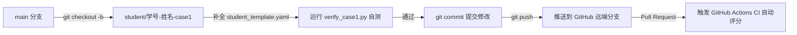

# 《环境规划与管理》学生随堂实训分支实践指南 (Practice Guide)

> **面向课程**：武汉大学《环境规划与管理》本科核心课程（第八讲）  
> **指导教师**：汤思琪 博士  
> **工程规范**：严格遵循 `agency-agents` 软件工程与 Git 分支管理最佳实践  

---

## 📌 1. 实训目的与总体流程

本实训旨在帮助环境工程专业本科生建立**“生命周期评价 (LCA) + 技术经济分析 (TEA) + 工业代码工程化”**的综合规划分析能力。同学们将基于美国能源部（US DOE）官方工业技术评估案例，在 GitHub 协作模式下通过新建个人分支完成指定案例的 Python 化配置、对标计算与自动化验证。



---

## 🌿 2. Git 分支管理与协作规范 (Git Workflow Master)

根据现代开源工程与团队协作规范，**严禁直接修改或向 `main` 分支推送代码**。所有同学必须在个人分支上独立作业。

### 2.1 分支命名规范
分支名称必须严格遵循以下命名结构：
- **案例一（余热回收）**：`student/<学号>-<姓名拼音>-case1`  
  *示例：`student/2023300001-zhangsan-case1`*
- **案例二（催化剂）**：`student/<学号>-<姓名拼音>-case2`  
  *示例：`student/2023300001-zhangsan-case2`*

### 2.2 规范化提交信息 (Conventional Commits)
每次提交应使用规范的 Git Commit Message：
- 新增/填报配置：`feat(case1): complete waste heat recovery input parameters`
- 修改/调试配置：`fix(case2): correct equivalence ratio to 1.35`
- 运行验证/测试：`test(case1): verify calculation against US DOE benchmark`
- 文档记录/实验总结：`docs(case1): add reflective notes and comparison results`

---

## 🛠️ 3. 随堂实战操作四部曲

### 第一步：克隆代码仓与环境初始化
打开终端（或 Anaconda Prompt），进入工作目录：
```bash
# 1. 克隆教学仓库
git clone https://github.com/whu-course-EnvironPlanManag/pyTECHTEST.git
cd pyTECHTEST

# 2. 激活预先配置好的 Conda 虚拟环境 (详见 README.md 第 3 节)
conda activate pytechtest

# 3. 验证本地依赖与核心包是否就绪
pytest -v tests/
```

### 第二步：检出个人实训分支
根据你当前练习的案例，新建并切换至个人实训分支：
```bash
# 以练习案例 1 为例：
git checkout -b student/2023300001-zhangsan-case1
```

### 第三步：查阅官方 Excel 并补全对应配置

#### 【案例一：工业余热回收系统练习 (Case 1)】
- **参考 Excel**：打开 `data/excel_templates/Example TECHTEST 1.0 Waste Heat Recovery (Process).xlsx`；
- **答题文件**：编辑 `practice/case1_waste_heat/student_template.yaml`；
- **重点考查**：
  1. 设备购置 CapEx 与 5% 年化维护费的折旧积分；
  2. 操作工 FTE 与 72% 综合福利间接费率的人工 OpEx 计算；
  3. 电力单耗（基准 3,758.4 kWh vs. 新技术 1,548.8 kWh）对生命周期碳强度的贡献；
- **自测命令**：
  ```bash
  python practice/case1_waste_heat/verify_case1.py
  ```

#### 【案例二：先进催化剂合成练习 (Case 2)】
- **参考 Excel**：打开 `data/excel_templates/TECHTEST 1.0 Manufacturilium Catalyst.xlsx`；
- **答题文件**：编辑 `practice/case2_catalyst/student_template.yaml`；
- **重点考查**：
  1. **非等量替代比（Equivalence Ratio）**：理解为何 10 kg 新催化剂等效替代 13.5 kg 传统催化剂，折算系数应设定为 `1.35`；
  2. **原材料副产物回收抵扣（Credit）**：在 `materials` 清单中填报 `unit_price: -500.0` 负单价抵扣项；
- **自测命令**：
  ```bash
  python practice/case2_catalyst/verify_case2.py
  ```

### 第四步：提交代码并创建 Pull Request
当自测验证输出 `🎉 恭喜！各项指标与美国能源部官方基准严格 100% 对齐！` 后：
```bash
# 1. 查看暂存状态
git status

# 2. 提交修改
git add practice/
git commit -m "feat(case1): complete waste heat recovery by <姓名>"

# 3. 推送至个人远端分支
git push -u origin student/2023300001-zhangsan-case1
```
4. 打开 GitHub 页面，点击 **Compare & pull request**，填写实训自查清单后提交 PR。

---

## 🤖 4. 自动化测试与评分规则 (GitHub Actions CI)

当你的 PR 提交后，GitHub 自动化 CI 流水线将在云端自动运行 `pytest -v tests/`：
- **测试通过（Green Checkmark ✅）**：表明计算模型完全符合美国能源部数值基准，代码格式规范；
- **测试失败（Red Cross ❌）**：点击进入 Actions 详情查看具体的失败项（如成本偏差过大、材料缺少抵扣项等），在本地分支修改后再次 `git commit` 并 `git push`，云端测试将自动重新评估。

---

## 💡 5. 常见问题与排错指南 (FAQ)

1. **Q: 为什么运行 `verify_case1.py` 时提示找不到模块？**  
   A: 请确认当前是否位于工程根目录 `pyTECHTEST/`，并已激活正确的 Conda 虚拟环境（`conda activate pytechtest`）。
2. **Q: 为什么案例 2 的成本节约总是算出来不对？**  
   A: 请重点检查：① `functional_unit.equivalence_ratio` 是否设置为了 `1.35`；② 是否在 `new_technology.materials` 中正确添加了 `unit_price: -500.0` 的副产物回收抵扣项。
3. **Q: 如何查看原版 Excel 详细公式与单元格对应？**  
   A: 本仓库在 `data/excel_templates/` 目录中完整内置了 US DOE 官方分发的原版工作簿，可随时在 Excel 中打开对照。
