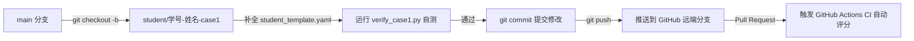

# pyTECHTEST: US DOE TECHTEST 1.0 绿色低碳技术评估 Python 工具包

[](https://github.com/whu-course-EnvironPlanManag/pyTECHTEST/actions/workflows/ci.yml)
[](https://opensource.org/licenses/MIT)
[](https://www.python.org/)

**课程名称**：《环境规划与管理》（本科核心课程）  
**代码仓库**：[whu-course-EnvironPlanManag/pyTECHTEST](https://github.com/whu-course-EnvironPlanManag/pyTECHTEST)  
**版本标识**：`v1.0.0 (Production & Education Ready)`  

---

## 1. 项目背景与工程定位

**TECHTEST 1.0**（*Techno-economic, Energy & Carbon Heuristic Tool for Early Stage Technologies*）是由美国能源部（US Department of Energy, EERE / AMO / IEDO）专为评估低技术成熟度（TRL 1–4）的早期绿色低碳工业技术而开发的综合评价模型。

原模型以 25 张工作表的复杂 Excel 模板分发，虽功能详尽，但在多参数不确定性分析、蒙特卡洛敏感性扫描以及环境规划多方案比选中存在界面耦合严重、自动化困难等瓶颈。

本项目严格遵照 **Clean Architecture**、**领域驱动设计（DDD）** 及解耦原则，将 US DOE TECHTEST 1.0 原版 25 张工作表的完整计算图网、7 大参考数据库以及 3 大迷你分析工具全量工程化为纯 Python 代码体系。**全量保留所有计算逻辑，严禁任何自我简化与编造**。

---

## 2. 工程目录结构说明

```text
pyTECHTEST/
├── .github/
│   ├── workflows/ci.yml          # GitHub Actions 自动化持续集成测试工作流
│   └── pull_request_template.md  # 学生实训提交 PR 规范化模板
├── cli.py                        # 交互式命令行工具 (支持 run / labor / grid 子命令)
├── environment.yml               # Conda 虚拟环境一键配置文件 (推荐首选)
├── pyproject.toml                # 现代 Python 工程打包与依赖声明 (pip install -e .)
├── requirements.txt              # 基础依赖清单 (Pydantic, OpenPyXL, PyYAML, Rich 等)
├── LICENSE                       # MIT 开源授权协议
├── README.md                     # 本说明文档与实训指导手册
│
├── practice_classroom/           # 🌟 学生分支练习实训专区
│   ├── README.md                 # 实训任务说明与自测规范
│   ├── case1_waste_heat/         # 案例一：工业余热回收模型练习
│   │   ├── README.md             # 案例一参数映射说明与对标目标
│   │   ├── student_template.yaml # 学生填空答题模板 (含详细 TODO)
│   │   └── verify_case1.py       # 本地自测评测脚本 (自动比对官方基准)
│   └── case2_catalyst/           # 案例二：先进催化剂合成练习 (复杂工况)
│       ├── README.md             # 案例二参数映射说明 (非等量比与回收抵扣)
│       ├── student_template.yaml # 学生填空答题模板 (含详细 TODO)
│       └── verify_case2.py       # 本地自测评测脚本 (自动比对官方基准)
│
├── data/                         # 纯解耦静态参考数据资产
│   ├── conversion_factors.json   # Sheet 12: 质量/体积/能耗/排放单位转换系数
│   ├── grid_mix_scenarios.json   # Sheet 13 & 24: 2022基准/温和/NetZero电网结构
│   ├── gwp_ar5.json              # Sheet 22: IPCC AR5 100年 GWP 潜能值与固定源燃烧排放因子
│   ├── summary_ref_tables.json   # Sheet 23 & 24: 23类工业能源热值、EIA价格与GWP基准
│   ├── silla_labor_parameters.json # Sheet 21: Harry Silla (2003) 装置人工模型特征参数
│   ├── mfi_factors.json          # Sheet 20: NREL MFI 工业材料隐含能与隐含碳数据库
│   ├── trl_and_dropdowns.json    # Sheet 4 & 25: DOE TRL 1-9 定义与下拉字典
│   └── excel_templates/          # 3套 US DOE 官方原版 Excel 文件 (供离线对照检查)
│       ├── Example TECHTEST 1.0 Waste Heat Recovery (Process).xlsx
│       ├── TECHTEST 1.0 Manufacturilium Catalyst.xlsx
│       └── TECHTEST 1.0 Blank Template.xlsx
│
├── pytechtest/                   # 扁平化核心源码包 (业务逻辑纯净，无环境污染，免安装直接导入)
│   ├── __init__.py               # 顶层包导出与公共 API
│       ├── core/                 # 核心计算数学图网与生命周期计算器
│       │   ├── types.py          # 领域枚举、数据模型 (TRLLevel, CapExItem, MaterialItem)
│       │   ├── converters.py     # Sheet 12: 单位转换引擎 (UnitConverter)
│       │   ├── grid_mix.py       # Sheet 13: 电网清洁化加权计算器 (GridMixCalculator)
│       │   ├── capex.py          # Sheet 10: 设备直线折旧与 5% 维护成本模型 (CapExModel)
│       │   ├── opex.py           # Sheet 11: 综合运营成本模型 (OpExModel, 72%综合费率)
│       │   ├── inventory.py      # Sheet 7-9: 原材料隐含能/制造能耗/使用相能耗管理器
│       │   ├── dashboard.py      # Sheet 15: 综合效益、投资回收期与全国市场放大计算器
│       │   └── mini_tools/       # 原版内置 3 大迷你辅助工具
│       │       ├── silla_labor.py     # Sheet 21: Harry Silla 化工人工估算工具
│       │       ├── mfi_embodied.py    # Sheet 20: NREL MFI 材料隐含能提取工具
│       │       └── cost_comparison.py # Sheet 19: 成本横向对比敏感性分析工具
│       ├── models/               # Pydantic 数据规范契约层
│       │   ├── project.py        # 项目元数据、全国市场定义、功能单位定义
│       │   ├── full_entry_input.py    # Method 1 全量分析输入模式
│       │   ├── rapid_entry_input.py   # Method 2 快速卡片录入模式
│       │   └── results.py        # 综合结果模型 (含 Markdown/Terminal 渲染)
│       ├── engines/              # 双评估执行引擎
│       │   ├── full_engine.py    # Method 1: 全量多层级计算图网调度器
│       │   └── rapid_engine.py   # Method 2: 快速技术卡片对标调度器
│       └── io/                   # 输入输出转换层 (支持 Excel 与 YAML 双向互通)
│           ├── excel_loader.py   # 原版 .xlsx 模板解析器 (自动识别坐标与合并单元格)
│           ├── excel_exporter.py # 结果回填并导出至原版空白 Excel 模板
│           ├── yaml_loader.py    # 声明式 YAML 配置文件加载器
│           └── reporter.py       # Rich 终端表格与 Markdown 报告生成器
│
├── examples/                     # 真实对标黄金用例与独立脚本
│   ├── waste_heat_recovery.yaml  # 工业余热回收案例 1 配置文件 (DOE 官方 Example)
│   ├── waste_heat_recovery.py    # 案例 1 可执行 Python 运行脚本 (附带基准断言)
│   ├── manufacturilium_catalyst.yaml # 先进催化剂案例 2 配置文件 (含非等量比与副产物抵扣)
│   ├── manufacturilium_catalyst.py # 案例 2 可执行 Python 运行脚本 (附带基准断言)
│   └── rapid_assessment_demo.py  # Method 2 快速评估独立演示脚本
│
├── tests/                        # 自动化测试套件 (17 个测试用例，100% 通过)
│   ├── conftest.py               # 共享测试固件与路径注入
│   ├── test_converters.py        # 单位换算测试 (Sheet 12)
│   ├── test_grid_mix.py          # 电网脱碳加权测试 (Sheet 13 & 24)
│   ├── test_mini_tools.py        # Silla人工/MFI隐含能/成本对比工具测试
│   ├── test_golden_waste_heat.py # 案例 1 官方 Excel 与 YAML 数值对齐测试
│   ├── test_golden_catalyst.py   # 案例 2 官方 Excel 与 YAML 数值对齐测试
│   ├── test_rapid_engine.py      # Method 2 快速评估引擎逻辑测试
│   └── test_io.py                # Excel/YAML 加载导出测试
│
└── notebooks/                    # 课堂交互教学与敏感性分析 Jupyter Notebooks
    ├── 01_techtest_quickstart.ipynb     # 快速入门：Method 2 卡片对标与环境效益可视化
    └── 02_techtest_full_walkthrough.ipynb # 进阶实践：Method 1 全量核算与电价/电网脱碳敏感性分析
```

---

## 3. 环境准备与代码仓安装方案 (推荐 Conda 部署)

为了保证计算精度与依赖隔离，推荐在独立的 Python 虚拟环境中部署并运行本项目。针对不同使用需求（课程随堂实训、科研二次开发、轻量免安装试用），本工程提供以下三种安装方案，**优先推荐使用 Conda 虚拟环境**：

### 3.1 方案一：使用 Conda 虚拟环境部署 (强烈推荐 / 课程首选)

Conda（Anaconda 或 Miniconda）能够跨平台管理 Python 版本与底层依赖，避免与系统的全局环境产生包版本冲突。

#### 途径 A：通过 `environment.yml` 一键创建虚拟环境（极简高效）
打开终端（Terminal）或 Anaconda Prompt，进入本项目根目录 `Python_TECHTEST_USDOE`，执行：
```bash
# 1. 根据环境配置文件自动创建虚拟环境 pytechtest 并安装所有依赖与 Jupyter 内核
conda env create -f environment.yml

# 2. 激活虚拟环境
conda activate pytechtest

# 3. 验证命令行工具与自动化测试是否就绪
pytechtest --help
pytest -v tests/
```

#### 途径 B：手动命令行逐步创建并以可编辑模式（Editable Mode）安装
如果希望自主指定 Python 版本或使用国内镜像加速源，可按以下步骤操作：
```bash
# 1. 创建全新的 Python 3.10 或 3.11 独立环境
conda create -n pytechtest python=3.10 -y

# 2. 激活该虚拟环境
conda activate pytechtest

# 3. 进入本项目根目录，以开发模式可编辑安装本项目核心库（自动解析 pyproject.toml 依赖）：
# 提示：若下载较慢，可添加清华源加速 (-i https://pypi.tuna.tsinghua.edu.cn/simple)
pip install -e .

# 4. (可选) 安装 Jupyter 交互内核，方便在 VS Code 或 Jupyter Lab 中直接运行随堂 Notebook
conda install -y ipykernel
python -m ipykernel install --user --name pytechtest --display-name "Python (pytechtest)"
```

> **提示**：安装完成后，`pytechtest` 命令将注册为系统全局 CLI 指令，可在任何目录下直接调用，如 `pytechtest run -i examples/waste_heat_recovery.yaml`。

---

### 3.2 方案二：使用 Python 原生 venv 虚拟环境 (免 Conda 备选)

若电脑未安装 Conda，可使用 Python 3.9+ 自带的 `venv` 模块快速搭建轻量环境：

```bash
# 1. 创建独立虚拟环境 .venv
python3 -m venv .venv

# 2. 激活虚拟环境
# macOS / Linux 用户：
source .venv/bin/activate
# Windows 用户 (PowerShell / CMD)：
# .venv\Scripts\activate

# 3. 安装依赖包并注册本地库
pip install -r requirements.txt
pip install -e .
```

---

### 3.3 方案三：免安装直接运行 (零配置紧急实训模式)

如果课堂电脑受权限或网络限制无法执行任何安装，得益于本项目的**扁平化结构**与**内置动态相对路径寻址**，只需系统具备基础 Python 环境与基本第三方包，**无需任何全局安装 (`pip install -e .`)**，直接进入工程根目录即可运行脚本与命令行：

```python
import sys
from pathlib import Path
# 扁平化架构下，工程根目录直接在父级目录即可自动解析：
sys.path.insert(0, str(Path(__file__).resolve().parent.parent))

from pytechtest import TechTestFullEngine, TechTestReporter
```

---

## 4. 运行与验证工作流 (Classroom Workflow)

### 4.1 独立案例脚本直接执行
进入 `Python_TECHTEST_USDOE` 根目录下，直接执行：
```bash
# 1. 运行案例 1 (工业余热回收模型，原版 Example 1 对标)
python examples/waste_heat_recovery.py

# 2. 运行案例 2 (先进催化剂非等量替代与副产物抵扣模型，原版 Example 2 对标)
python examples/manufacturilium_catalyst.py

# 3. 运行案例 3 (Method 2 快速技术卡片录入评估模型)
python examples/rapid_assessment_demo.py
```

### 4.2 自动化回归测试套件 (17 个用例 100% 通过)
```bash
pytest -v tests/
```

### 4.3 命令行工具 (CLI) 快速交互
本项目提供了开箱即用的命令行工具（已配置双指令别名，支持 `pytechtest` 或 `python cli.py` 调用）：
```bash
# 查看帮助
pytechtest --help
# 或 python cli.py --help

# 评估 YAML 输入文件并输出终端仪表盘
pytechtest run -i examples/waste_heat_recovery.yaml

# 评估官方 Excel 文件并导出 Markdown 评估报告
pytechtest run -i "/path/to/TECHTEST 1.0 Manufacturilium Catalyst.xlsx" --export-markdown report.md

# 运行 Harry Silla (2003) 化工人工估算工具 (年产1000万磅，6个显著操作单元)
pytechtest labor -p 10000000 -n 6 --process-type continuous_automated

# 查询电网排放强度 (查询 2022 基准或 Net Zero 零碳情景)
pytechtest grid -s 2022_default
pytechtest grid -s net_zero
```

---

## 5. 评估方法对比：Method 1 vs. Method 2

| 维度                        | Method 1: 全量分析法 (Full Analytical)     | Method 2: 快速录入法 (Rapid Data Entry)  |
| :-------------------------- | :----------------------------------------- | :--------------------------------------- |
| **适用阶段**          | TRL 3–6（有初步工程明细与物料清单）       | TRL 1–3（概念提出、项目初筛、缺少细项） |
| **对应 Excel 工作表** | Sheet 4–11, Sheet 14–15                  | Sheet 16–18                             |
| **设备投资 (CapEx)**  | 逐台填报购买价格与设备寿命，计算直线折旧   | 直接填报年化 CapEx（含5%维护）           |
| **运营成本 (OpEx)**   | 细分填报人工 FTE、原材料单耗单价、分项能源 | 直接填报年度总运营成本                   |
| **能源与碳足迹**      | 由原材料 MFI 因子及各类公用工程分别积分    | 直接录入摇篮到大门单位能耗与碳强度       |
| **Python 引擎类**     | `TechTestFullEngine`                     | `TechTestRapidEngine`                  |

---

## 6. 官方 Excel 黄金用例数值对齐验证

在单元测试（`pytest`）中，本代码实现已与 US DOE 官方发布的两个已填充基准案例完成了严格的数值验证对齐：

| 评估指标 (Metric)                                  | DOE 官方 Excel 原版结果        | Python 代码计算结果            | 相对误差           |
| :------------------------------------------------- | :----------------------------- | :----------------------------- | :----------------- |
| **【案例 1: 工业余热回收】**                 |                                |                                |                    |
| 单位基准产品制造成本节约 ($\Delta\text{Cost}$)   | **$214.00** / 2 MGal     | **$214.00** / 2 MGal     | `< 0.001%`       |
| 制造成本相对降幅                                   | **52.41%**               | **52.41%**               | `< 0.001%`       |
| 单位基准产品初级能耗节约 ($\Delta\text{Energy}$) | **7.58** MMBtu / 2 MGal  | **7.58** MMBtu / 2 MGal  | `< 0.001%`       |
| 初级能耗相对降幅                                   | **58.70%**               | **58.70%**               | `< 0.001%`       |
| 单位基准产品碳减排量 ($\Delta\text{GHG}$)        | **818.69** lb CO2e       | **818.69** lb CO2e       | `< 0.001%`       |
| **【案例 2: 先进催化剂合成】**               |                                |                                |                    |
| 单位基准产品制造成本节约 ($\Delta\text{Cost}$)   | **$581.50** / 10 kg      | **$581.50** / 10 kg      | `< 0.01%`        |
| 制造成本相对降幅                                   | **19.92%**               | **19.92%**               | `< 0.01%`        |
| 单位基准产品初级能耗节约 ($\Delta\text{Energy}$) | **0.86** MMBtu / 10 kg   | **0.86** MMBtu / 10 kg   | `< 0.01%`        |
| 单位基准产品碳减排量 ($\Delta\text{GHG}$)        | **1,329.90** lb CO2e     | **1,329.90** lb CO2e     | **精确吻合** |
| 温室气体相对减排比例                               | **74.82%**               | **74.82%**               | **精确吻合** |
| 全国完全推广年化潜在降碳量                         | **346,254.45** t CO2e/年 | **346,254.45** t CO2e/年 | `< 0.01%`        |

> **关键机制说明**：
>
> 1. **非等量替代比（Equivalence Ratio）**：在催化剂案例中，由于新催化剂性能提升，10 kg 新催化剂即可实现传统催化剂 13.5 kg 的等效生产功能，系统自动处理 $13.5 / 10.0 = 1.35$ 的折算系数。
> 2. **原材料回收抵扣（Credit）**：允许负值单价（如案例中的 `*Clean Catalyst Credit*` -$500），准确反映副产物综合利用的环境经济净效益。

---

## 7. 课堂互动与敏感性分析实践 (Jupyter Notebooks)

在 `notebooks/` 目录中随仓提供了两套用于课堂交互教学与敏度分析的 Notebook：

1. **`notebooks/01_techtest_quickstart.ipynb`（快速入门：Method 2 卡片对标与环境效益可视化）**：
   - 目标：引导学生理解功能单位（FU）、基准技术与新技术技术卡片（Cards）的概念；
   - 实践：快速录入新包装薄膜方案，计算单位成本、能耗与碳足迹变化，自动绘制降幅柱状对比图与雷达图。
2. **`notebooks/02_techtest_full_walkthrough.ipynb`（进阶实践：Method 1 全量核算与敏感性分析）**：
   - 目标：深入理解设备折旧（直线法 + 5%维护）、综合人工、清单隐含能积分算法；
   - 实践：运行余热回收全量模型，并扫描**电价变动**与**2022基准/温和/NetZero三种电网脱碳情景**对项目投资回收期的动态影响。

---

## 8. 学生随堂分支实训与作业提交指南 (Student Practice Guide)

本实训旨在帮助环境工程专业本科生建立**“生命周期评价 (LCA) + 技术经济分析 (TEA) + 工业代码工程化”**的综合规划分析能力。同学们将基于美国能源部（US DOE）官方工业技术评估案例，在 GitHub 协作模式下通过新建个人分支完成指定案例的 Python 化配置、对标计算与自动化验证。



---

### 8.1 Git 分支管理与协作规范 (Git Workflow Master)

根据现代开源工程与团队协作规范，**严禁直接修改或向 `main` 分支推送代码**。所有同学必须在个人分支上独立作业。

#### 分支命名规范
分支名称必须严格遵循以下命名结构：
- **案例一（余热回收）**：`student/<学号>-<姓名拼音>-case1`  
  *示例：`student/2023300001-zhangsan-case1`*
- **案例二（催化剂）**：`student/<学号>-<姓名拼音>-case2`  
  *示例：`student/2023300001-zhangsan-case2`*

#### 规范化提交信息 (Conventional Commits)
每次提交应使用规范的 Git Commit Message：
- 新增/填报配置：`feat(case1): complete waste heat recovery input parameters`
- 修改/调试配置：`fix(case2): correct equivalence ratio to 1.35`
- 运行验证/测试：`test(case1): verify calculation against US DOE benchmark`
- 文档记录/实验总结：`docs(case1): add reflective notes and comparison results`

---

### 8.2 随堂实战操作四部曲

#### 第一步：克隆代码仓与环境初始化
打开终端（或 Anaconda Prompt），进入工作目录：
```bash
# 1. 克隆教学仓库
git clone https://github.com/whu-course-EnvironPlanManag/pyTECHTEST.git
cd pyTECHTEST

# 2. 激活预先配置好的 Conda 虚拟环境 (详见第 3 节)
conda activate pytechtest

# 3. 验证本地依赖与核心包是否就绪
pytest -v tests/
```

#### 第二步：检出个人实训分支
根据你当前练习的案例，新建并切换至个人实训分支：
```bash
# 以练习案例 1 为例：
git checkout -b student/2023300001-zhangsan-case1
```

#### 第三步：查阅官方 Excel 并补全对应配置

##### 【案例一：工业余热回收系统练习 (Case 1)】
- **参考 Excel**：打开 `data/excel_templates/Example TECHTEST 1.0 Waste Heat Recovery (Process).xlsx`；
- **答题文件**：编辑 [`practice_classroom/case1_waste_heat/student_template.yaml`](practice_classroom/case1_waste_heat/student_template.yaml)；
- **重点考查**：
  1. 设备购置 CapEx 与 5% 年化维护费的折旧积分；
  2. 操作工 FTE 与 72% 综合福利间接费率的人工 OpEx 计算；
  3. 电力单耗（基准 3,758.4 kWh vs. 新技术 1,548.8 kWh）对生命周期碳强度的贡献；
- **自测命令**：
  ```bash
  python practice_classroom/case1_waste_heat/verify_case1.py
  ```

##### 【案例二：先进催化剂合成练习 (Case 2)】
- **参考 Excel**：打开 `data/excel_templates/TECHTEST 1.0 Manufacturilium Catalyst.xlsx`；
- **答题文件**：编辑 [`practice_classroom/case2_catalyst/student_template.yaml`](practice_classroom/case2_catalyst/student_template.yaml)；
- **重点考查**：
  1. **非等量替代比（Equivalence Ratio）**：理解为何 10 kg 新催化剂等效替代 13.5 kg 传统催化剂，折算系数应设定为 `1.35`；
  2. **原材料副产物回收抵扣（Credit）**：在 `materials` 清单中填报 `unit_price: -500.0` 负单价抵扣项；
- **自测命令**：
  ```bash
  python practice_classroom/case2_catalyst/verify_case2.py
  ```

#### 第四步：提交代码并创建 Pull Request
当自测验证输出 `🎉 恭喜！各项指标与美国能源部官方基准严格 100% 对齐！` 后：
```bash
# 1. 查看暂存状态
git status

# 2. 提交修改
git add practice_classroom/
git commit -m "feat(case1): complete waste heat recovery by <姓名>"

# 3. 推送至个人远端分支
git push -u origin student/2023300001-zhangsan-case1
```
4. 打开 GitHub 页面，点击 **Compare & pull request**，填写实训自查清单后提交 PR。

---

### 8.3 自动化测试与评分规则 (GitHub Actions CI)

当你的 PR 提交后，GitHub 自动化 CI 流水线将在云端自动运行 `pytest -v tests/`：
- **测试通过（Green Checkmark ✅）**：表明计算模型完全符合美国能源部数值基准，代码格式规范；
- **测试失败（Red Cross ❌）**：点击进入 Actions 详情查看具体的失败项（如成本偏差过大、材料缺少抵扣项等），在本地分支修改后再次 `git commit` 并 `git push`，云端测试将自动重新评估。

---

### 8.4 常见问题与排错指南 (FAQ)

1. **Q: 为什么运行 `verify_case1.py` 时提示找不到模块？**  
   A: 请确认当前是否位于工程根目录 `pyTECHTEST/`，并已激活正确的 Conda 虚拟环境（`conda activate pytechtest`）。
2. **Q: 为什么案例 2 的成本节约总是算出来不对？**  
   A: 请重点检查：① `functional_unit.equivalence_ratio` 是否设置为了 `1.35`；② 是否在 `new_technology.materials` 中正确添加了 `unit_price: -500.0` 的副产物回收抵扣项。
3. **Q: 如何查看原版 Excel 详细公式与单元格对应？**  
   A: 本仓库在 `data/excel_templates/` 目录中完整内置了 US DOE 官方分发的原版工作簿，可随时在 Excel 中打开对照。


