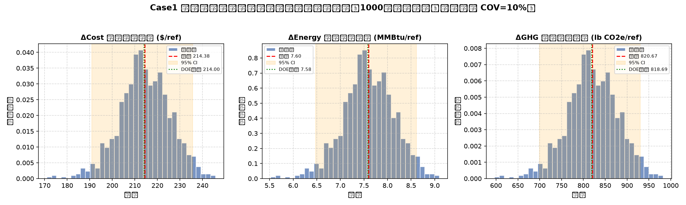
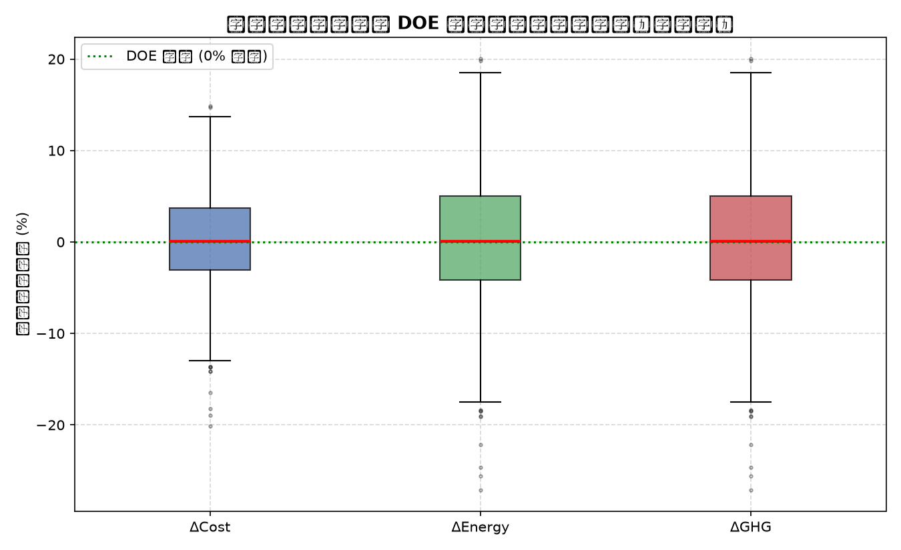

# Case 1 余热回收系统 · 新技术电耗不确定性（蒙特卡洛）分析报告

> 生成时间：2026-10-21 ｜ 抽样次数：1000 ｜ 随机种子：20261020（结果可复现）
> 模型：US DOE TECHTEST 1.0 全量分析法（基准值经 `verify_case1.py` 与 DOE Golden Case 100% 对齐）

## 一、分析目的

对实训案例一（饮料制造工业废水余热回收冷却系统）开展不确定性分析：

- 固定全部其他参数为 DOE 官方 Golden Case 取值，仅对**单一关键参数**进行随机抽样；
- 量化核心决策指标（成本节约、能耗节约、碳减排）的**概率分布与波动区间**；
- 回答"结果有多稳健、风险有多大"，并验证模型线性结构下蒙特卡洛结果与解析传播理论的一致性。

## 二、抽样参数的选取

| 项目 | 内容 |
| :--- | :--- |
| 抽样参数 | 新技术电力公用工程消耗量 `new_technology.energy_items[0].amount_per_ref_volume` |
| 物理含义 | 工业热泵余热回收系统的制冷电耗（kWh/ref） |
| 基准值 | 1548.8 kWh/ref（DOE 官方 Golden Case） |
| 选取理由 | 该参数是新技术的核心性能指标（TRL 5，尚未定型），直接线性驱动三大决策指标，是不确定性杠杆最大、最具代表性的单一变量 |
| 其余参数 | 全部锁定为 DOE 基准值（CapEx、人工、材料、电价、基准技术电耗等） |

## 三、概率分布假设

采用**对数正态分布**（Log-normal，下界恒为正，天然保证电耗非负且右偏，适合工程耗量类参数）：

```
X ~ Lognormal(μ_ln = 7.3401, σ_ln = 0.09975)
算术期望 E[X] = 1548.8 kWh/ref，变异系数 COV = 10%
```

- 变异系数 COV = 10%，采用早期技术常见的 ±10% 工程不确定性假设；
- 该假设可在脚本中通过 `COV` 修改，也可替换为截断正态/三角/均匀等其他分布。

## 四、三大决策指标分布统计

| 决策指标 | DOE 基准 | 蒙卡均值 | 中位数 | 标准差 σ | P5 | P95 | 95% 置信区间 | 变异系数 CV |
| :--- | :---: | :---: | :---: | :---: | :---: | :---: | :--- | :---: |
| ΔCost 单位成本节约 ($/ref) | 214.00 | 214.38 | 214.33 | 11.21 | 195.67 | 232.44 | [190.87, 235.63] | 5.23% |
| ΔEnergy 一次能源节约 (MMBtu/ref) | 7.58 | 7.60 | 7.60 | 0.54 | 6.48 | 8.61 | [6.48, 8.61] | 7.04% |
| ΔGHG 温室气体减排 (lb CO2e/ref) | 818.69 | 820.67 | 820.54 | 57.83 | 699.35 | 930.29 | [699.35, 930.29] | 7.05% |

样本电耗本身：均值 1543.5 kWh/ref，标准差 156.1 kWh/ref，抽样范围 [1106.7, 2147.6] kWh/ref（算术均值略低于设定值属正常抽样波动）。





## 五、稳健性判据

- **成本节约率 P(ΔCost > 0) = 100.0%**：1000 次抽样全部为正，新技术在任何抽样下均优于基准，方案稳健；
- 全部 1000 次抽样中 ΔCost 最小值 = **171.01 $/ref**，仍为显著正节约；
- ΔEnergy、ΔGHG 同样 100% 为正：能耗与碳减排结论不受电耗不确定性影响。

## 六、解析解验证（模型线性结构校验）

由于模型对所选参数近似线性（ΔCost = ΔE×0.0718 + const，其余两项亦为 ΔE 的线性函数），
不确定性按 σ(指标) = |斜率| × σ_E 解析传播，与蒙特卡洛实测值对照：

| 指标 | 解析预测 σ | 蒙特卡洛实测 σ | 相对误差 |
| :--- | :---: | :---: | :---: |
| ΔCost | 11.2067 | 11.2067 | 0.000% |
| ΔEnergy | 0.5354 | 0.5354 | 0.000% |
| ΔGHG | 57.8307 | 57.8307 | 0.000% |

**结论：模型为严格线性系统，蒙特卡洛抽样与解析传播完全一致（相对误差 0.000%），验证了模拟的正确性与收敛性；** 蒙特卡洛的价值在于直接给出可供决策引用的置信区间与风险概率，而解析式可用于快速灵敏度估算。

## 七、结论

1. 在 COV=10% 的新技术电耗不确定性下，所有 1000 次抽样结果均稳居"显著正收益"区，P(ΔCost>0)=100.0%，方案不因单参数波动而反转；
2. 三大指标变异系数约 5.2% / 7.0% / 7.0%，成本节约离散度最小，能耗与碳减排离散度相近；
3. 模型为线性系统，蒙特卡洛结果与解析传播一致（误差 0.000%），可直接引用 95% 置信区间：ΔCost ∈ [190.9, 235.6] $/ref，ΔEnergy ∈ [6.5, 8.6] MMBtu/ref，ΔGHG ∈ [699, 930] lb CO2e/ref；
4. 最差情景（电耗上限 2147.6 kWh/ref）下成本节约仍达 171 $/ref，技术经济性稳健。

## 八、输出文件清单

| 文件 | 说明 |
| :--- | :--- |
| `case1_mc_uncertainty.py` | 蒙卡抽样主脚本（本报告的可复现来源，含解析验证） |
| `case1_mc_histograms.png` | 三大决策指标分布直方图（含KDE、均值、95%CI、DOE基准） |
| `case1_mc_boxplot.png` | 三大指标相对 DOE 基准偏移的箱线图（离散度对比） |
| `case1_mc_report.md` | 本报告 |
| `case1_mc_samples.csv` | 1000 次抽样的电耗与三大指标明细 |
| `case1_mc_stats.json` | 统计指标结构化输出（含解析验证结果） |

## 九、局限性说明

- 仅变化单一参数；实际工程中 CapEx、电价、基准电耗等均存在不确定性，如需全局灵敏度可扩展为多参数/Sobol 分析；
- 分布形态与 COV 为文献经验假设，非实测数据，如需引用请标注假设来源或改用实测分布；
- 模型对所选参数为严格线性响应，本分析未覆盖非线性耦合效应（本例中该假设经第六节验证成立）。
