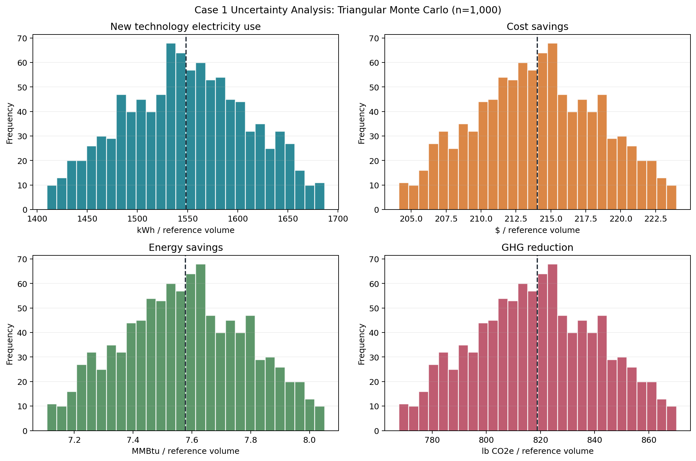

# Case 1 余热回收项目不确定性分析报告

## 摘要

本报告针对工业余热回收案例开展单参数蒙特卡洛分析。以新技术单位电耗为不确定参数，采用三角分布抽样 1,000 次，并在每次抽样后调用 TECHTEST 完整计算引擎，观察单位成本节约、节能量和温室气体减排的变化。设定范围内，三项改善指标均保持为正；结果仅反映电耗这一项输入的不确定性。

## 1. 案例与分析目标

案例比较饮料制造废水冷却中的余热回收新技术与传统蒸发式冷凝器。分析以配置文件定义的 **2.0 Million Gallons** 处理量为参考功能单位，关注新技术单位电耗变化对成本、能源和温室气体指标的影响。

本分析的目标不是重新校准官方基准值，而是回答：当新技术实际电耗围绕当前估计值波动时，预期节约与减排指标的分布如何，改善方向是否会改变。

## 2. 方法与假设

- **抽样参数**：新技术单位电耗，基准值 **1548.80 kWh/ref**。
- **概率分布**：三角分布，最小值 **1393.92**、众数 **1548.80**、最大值 **1703.68 kWh/ref**。众数取当前配置值，上下界分别为基准值的 90% 和 110%。
- **模拟次数与复现**：1,000 次，随机种子为 `20261021`。
- **控制变量**：除新技术单位电耗外，其余市场、成本、材料、设备、劳动力、电价和电网参数均保持配置文件基准值。
- **计算方式**：每轮将抽样电耗写入新技术配置，并重新运行完整模型。报告中的 90%模拟区间指第 5 至第 95 百分位数，不是基于实测数据构造的统计置信区间。

## 3. 抽样参数结果

| 参数 | 中位数 | 5%分位 | 95%分位 | 最小抽样值 | 最大抽样值 |
|---|---:|---:|---:|---:|---:|
| 新技术单位电耗 (kWh/ref) | 1548.5293 | 1442.3017 | 1651.6507 | 1409.6894 | 1686.5695 |

## 4. 模型输出

| 指标 | 单位 | 中位数 | 5%分位 | 95%分位 | 最小值 | 最大值 |
|---|---|---:|---:|---:|---:|---:|
| 单位成本节约 | $ / ref | 214.0216 | 206.6175 | 221.6488 | 204.1103 | 223.9903 |
| 成本节约比例 | % | 52.4098 | 50.5966 | 54.2775 | 49.9827 | 54.8509 |
| 单位能耗节约 | MMBtu / ref | 7.5776 | 7.2257 | 7.9401 | 7.1066 | 8.0514 |
| 能耗节约比例 | % | 58.7066 | 55.9805 | 61.5147 | 55.0575 | 62.3768 |
| 单位温室气体减排 | lb CO2e / ref | 818.7912 | 780.5831 | 858.1502 | 767.6452 | 870.2335 |
| 温室气体减排比例 | % | 58.7982 | 56.0544 | 61.6246 | 55.1253 | 62.4923 |

### 改善方向概率

| 事件 | 模拟概率 |
|---|---:|
| 成本节约大于零 | 100.0% |
| 能耗节约大于零 | 100.0% |
| 温室气体减排大于零 | 100.0% |

## 5. 结果讨论

在本次抽样范围内，单位成本节约的中位数为 **$214.02/ref**，90%模拟区间为 **$206.62–$221.65/ref**。单位能耗节约中位数为 **7.5776 MMBtu/ref**，单位温室气体减排中位数为 **818.79 lb CO2e/ref**。

新技术单位电耗越高，其运行电力成本、能耗和电力相关排放越高；因此成本节约、节能量和减排量总体随之下降。尽管如此，在当前设定的 ±10% 波动范围中，三项指标的模拟值仍均为正，改善概率各为 100%。这说明在**该参数范围和其他输入固定的条件下**，案例的改善方向较稳定，但不能外推为现实项目的绝对保证。

## 6. 结果图

图中展示抽样电耗以及三个主要输出指标的频数分布；虚线标记各指标的模拟中位数。

## 7. 局限性

1. 本次只对新技术电耗进行不确定性分析，其他输入被固定；未评估设备投资、维护费率、电价、生产规模等参数的联合影响。
2. ±10% 范围是本次教学分析的假设，不是由现场测量、历史数据或专家判断拟合得到。
3. 模拟结果依赖当前配置及 TECHTEST 模型结构。若功能单位、系统边界、排放因子或输入数据改变，应重新运行并解释结果。
4. “100% 改善概率”仅表示 1,000 个样本在设定分布内均改善，不代表所有可能运行条件下都必然改善。

## 8. 结论

在新技术单位电耗以 **1548.80 kWh/ref** 为众数、在其上下 10% 范围内按三角分布变化的设定下，1,000 次模拟均得到正的成本节约、节能量和温室气体减排。中位数分别约为 **$214.02/ref**、**7.5776 MMBtu/ref** 和 **818.79 lb CO2e/ref**。结论应理解为单参数情景分析结果；更全面的风险评估需要为其他关键参数提供有依据的分布，并考虑参数间相关性。
