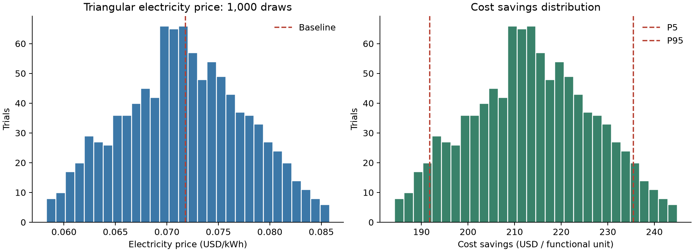

# 案例一：电价不确定性分析

## 方法与假设

选取电价为唯一不确定参数，采用三角分布：最低 0.05744、最可能 0.07180、最高 0.08616 美元/kWh。范围为课程基准上下浮动 20%，属于分析者设定的情景假设，没有作为历史电价统计分布。抽样 1000 次，随机种子为 20261020，使用 NumPy default_rng。

每次将同一抽样电价同时用于新技术和商业基准，避免将同一市场中的电价误设为两个独立变量。其他输入（电耗、投资、寿命、人工、材料、电网排放因子、市场规模）固定。每次调用完整课程引擎计算。

功能单位为冷却 2 Million Gallons 废水。输出重点为每功能单位成本节约，同时记录成本降幅、静态回收期、市场年节约、能耗节约和减排量。

## 结果

| 成本节约指标 | 美元/功能单位 |
|---|---:|
| 基准电价下结果 | 214.0022 |
| 蒙特卡洛均值 | 213.7232 |
| 样本标准差 | 13.1317 |
| 中位数 | 213.5545 |
| P5 | 191.7721 |
| P95 | 235.4984 |
| 抽样最小值 | 184.1603 |
| 抽样最大值 | 244.9024 |

1000 次中有 1000 次成本节约大于零。该样本比例仅适用于本次分布及固定条件，不等于实际项目的成功概率。P5–P95 是输出分布的中央 90% 分位区间，不是均值的置信区间。



## 解释与核验

两方案每功能单位电耗差为 3758.4 - 1548.8 = 2209.6 kWh。成本节约满足：基准节约 + 2209.6 ×（抽样电价 - 0.0718）。因此电价每上涨 0.01 美元/kWh，成本节约增加 22.096 美元/功能单位。脚本逐次将引擎结果与该独立关系核对。

电价区间两端的理论成本节约约为 182.2723 至 245.7320 美元/功能单位，整个假设区间均为正，因此在该单参数范围内，新技术的成本优势稳定。1000 次抽样不能排除其他参数或更宽电价范围下的不同结果。

回收期均值为 -11.9612 年，P5–P95 为 -13.6327 至 -10.5534 年。负值源于新技术初始投资更低，不能解释为现实中经过负数年回本。回收期分位数与成本节约分位数分别统计，不代表同一次抽样配对。

能耗节约固定为 7.57668884 MMBtu/功能单位，减排固定为 818.69092728 lb CO2e/功能单位，因为本次只改变价格，没有改变能耗或电网排放因子。脚本对每次抽样均检查这两项不变。

分析沿用课程引擎，当前引擎在 CapEx 与 OpEx 中重复计入维护费，且电耗换算未加入原 Excel 的 source-to-site 系数。本分析不修正这些实现，也不宣称对原 Excel 完整模型完成不确定性验证。

## 复现与文件

安装仓库依赖后，在仓库根目录运行：

```powershell
python practice_classroom/case1_waste_heat/monte_carlo.py
```

monte_carlo_samples.csv 保存全部 1000 次输入输出；monte_carlo_summary.json 保存统计量；monte_carlo.png 为分布图。固定种子用于复现，有限样本分位数仍有蒙特卡洛抽样误差。
